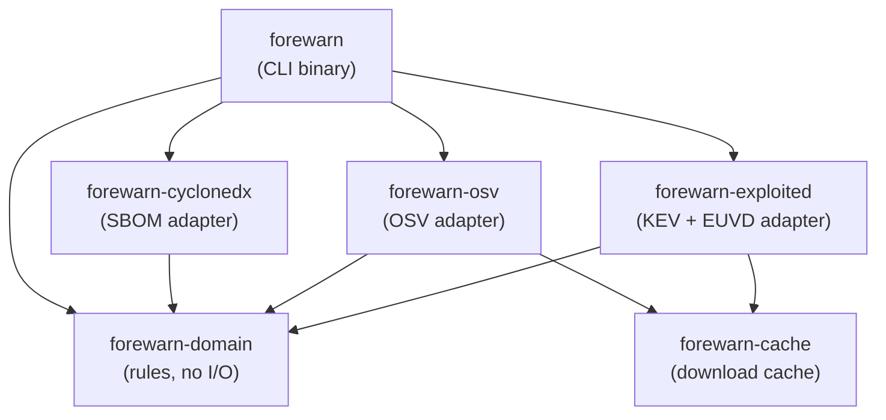
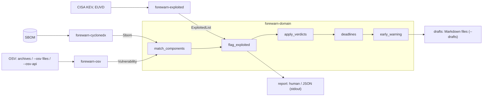

# Architecture

How `forewarn` is built: its crates, the boundaries between them, the flow of a run, and where each decision is
recorded. For what the commands do, read the [user guide](user-guide.md); for the exact behaviour of a capability,
its spec in [`specs/`](../specs/README.md).

## Principles

- **Hexagonal.** The domain (completeness, matching, exploited flagging, VEX verdicts, reporting deadlines, the content of the
  early warning) is pure Rust: no I/O, no dependency on an adapter. Adapters translate the outside world (CycloneDX,
  OSV, CISA KEV, EUVD, the terminal, files) into domain types and back. A change of regulatory or feed format touches
  an adapter, not the rules.
- **Never a scanner.** The SBOM comes from an existing tool (`cargo-cyclonedx`, `syft`, `cdxgen`…); `forewarn` reads
  it, it never detects dependencies.
- **Deterministic.** Matching by package URL and version, deadlines computed on UTC seconds: the same inputs at the
  same moment give the same report. No LLM, no heuristic.
- **Only inventories leave the CI.** By default only ecosystem names go out (to download the OSV archives); the CISA KEV
  and EUVD requests name no component. Sending the components out (`--osv-api`) is opt-in.
- **Third-party types stay in their adapter.** `cyclonedx-bom` types never leave `forewarn-cyclonedx`
  ([ADR 0002](adr/0002-parse-cyclonedx-with-cyclonedx-bom.md)); the OSV adapter has its own serde model
  ([ADR 0003](adr/0003-osv-adapter-crate-with-own-serde-model.md)).

## Crates

| Crate | Role | Main modules |
|---|---|---|
| `forewarn-domain` | The rules, no I/O | `sbom` (product, components, first-party), `completeness`, `matching` (+ private `version`: one ordering per ecosystem), `exploited`, `vex` (verdicts, the matches set aside), `deadlines`, `date`, `early_warning` (the fields of the draft), `purl`, `vulnerability` |
| `forewarn-cyclonedx` | Reads a CycloneDX JSON SBOM into `Sbom`, its VEX verdicts included, and a VEX document into `Verdict`s | single module |
| `forewarn-osv` | Reads OSV records, fetches ecosystem archives into the cache, queries the OSV API | `lib` (read), `fetch`, `api` |
| `forewarn-exploited` | Reads or fetches the exploited lists into `ExploitedList` | `kev`, `euvd` |
| `forewarn-cache` | Refresh policy, freshness, the files of each download, a file lock per entry | single module |
| `forewarn` | Arguments, wiring, exit codes, the writers | `main`, `args` (the options and their parsers), `report` (human and JSON), `early_warning` (Markdown draft), `drafts` (its files), `vex` (the verdicts of a run and their part of the reports), `escape` |

The dependency direction is enforced: `crates/forewarn/tests/workspace_policy.rs` fails when the domain depends on
another crate of the workspace, or when a crate does not inherit the workspace license and lints.

A hosted Forewarn service, kept in another repository, may depend on these crates (domain, adapters); nothing here
depends on it.

## Flow of `forewarn match`

1. **Arguments first.** Instants, refresh policy and conflicting flags are checked before anything is read (exit 2).
2. **SBOM.** The CycloneDX adapter returns the product (`metadata.component`), its manufacturer and the components,
   nested ones included, each tagged first-party or file when it is one, with its `bom-ref`
   ([spec](../specs/sbom-reading.md)), and the VEX verdicts of its `vulnerabilities`
   ([vex-verdicts](../specs/vex-verdicts.md)).
3. **Vulnerabilities.** From the cached archive of each ecosystem the SBOM uses, from local files, or from the OSV API
   ([osv-reading](../specs/osv-reading.md), [osv-fetching](../specs/osv-fetching.md)).
4. **Exploited lists.** The CISA KEV catalog, then the EUVD exploited list, each read from a file or fetched into the
   cache ([kev-reading](../specs/kev-reading.md), [euvd-reading](../specs/euvd-reading.md)).
5. **Domain.** Components are matched by package URL and version
   ([vulnerability-matching](../specs/vulnerability-matching.md)); records naming each other are grouped, one CVE per
   match; a match whose CVE a list names is flagged with its evidence
   ([exploited-flagging](../specs/exploited-flagging.md)); a match every VEX verdict naming it says does not affect the
   product is set aside with its verdict and evidence, out of what follows
   ([vex-verdicts](../specs/vex-verdicts.md), [ADR 0014](adr/0014-apply-the-vex-verdicts-in-the-domain-after-the-flagging.md)); its CRA article 14(2) deadlines are computed from the
   moment of awareness ([reporting-deadlines](../specs/reporting-deadlines.md)); the early warning's fields are filled
   or marked to complete ([early-warning-draft](../specs/early-warning-draft.md)).
6. **Output.** The drafts are written first, so that a failed write leaves standard output empty; then the report;
   then the exit code ([cli-match](../specs/cli-match.md), [cli-match-exploited](../specs/cli-match-exploited.md)).

`forewarn check` stops after step 2 and runs the completeness rules
([sbom-completeness](../specs/sbom-completeness.md), [cli-check](../specs/cli-check.md)).

## The cache

One directory (`$XDG_CACHE_HOME/forewarn/osv` by default) holds an entry per download: an OSV ecosystem, `cisa-kev`,
`euvd-exploited`. `forewarn-cache` owns what they share:

| Concern | Decision |
|---|---|
| When to download again | a refresh policy: `offline`, `if-missing`, `always`, or a maximum age ([ADR 0004](adr/0004-fetch-osv-ecosystem-archives-into-a-cache.md)) |
| Concurrent runs on one cache | a file lock per entry: readers share it, a downloader takes it alone ([ADR 0005](adr/0005-lock-each-ecosystem-of-the-osv-cache-with-a-file-lock.md), [0007](adr/0007-share-the-osv-cache-lock-between-readers.md), [0008](adr/0008-exploited-lists-crate-and-a-shared-cache-crate.md)) |
| A copy damaged outside `forewarn` | each download records the name and size of its files; a mismatch triggers a new download ([ADR 0010](adr/0010-record-the-files-of-a-download-to-tell-a-damaged-copy.md)) |
| EUVD, which has no single file | paged from its search into one file ([ADR 0009](adr/0009-page-the-euvd-search-for-its-exploited-list.md)) |

## Reporting deadlines and drafts

- Deadlines are computed in the domain on a UTC moment of its own (`date::Moment`, to the second), with no time crate:
  24 h, 72 h and 14 × 24 h added as whole seconds, never later than the periods of Regulation 1182/71; an adapter
  converts an offset to UTC ([ADR 0011](adr/0011-compute-the-reporting-deadlines-on-utc-seconds-of-the-domain.md)).
  They are the most expensive place for a bug: BDD scenarios cover them.
- The early warning follows the ENISA Single Reporting Platform glossary 1.6: field numbers and names as the glossary
  gives them ([ADR 0012](adr/0012-align-the-early-warning-draft-on-the-enisa-srp-glossary.md)).
- The domain decides the content; only the CLI crate knows the glossary's labels and order and writes the draft as
  Markdown, escaping every value from the SBOM or a feed so it cannot inject Markdown, HTML or hidden characters
  ([ADR 0013](adr/0013-write-the-early-warning-draft-in-markdown-in-the-cli-crate.md)).

## Where to change what

| To… | Touch |
|---|---|
| support a new ecosystem's version ordering | `forewarn-domain` (`version`, `purl`), then `forewarn-osv` if its OSV name differs |
| read another SBOM field | `forewarn-cyclonedx`, and the domain type it fills |
| change how a VEX verdict applies | `forewarn-domain` (`vex`) and the table of VEX-8 |
| add an exploited list | a module of `forewarn-exploited`, a `--<list>` / `--no-<list>` pair in the CLI |
| change a report's layout | `crates/forewarn/src/report.rs` (the JSON report is the stable one) |
| follow a new version of the ENISA glossary | `crates/forewarn/src/early_warning.rs` and the field table of `specs/early-warning-draft.md`; the domain only when a new field needs new data |

## Decisions

Every structural decision is an ADR in [`docs/adr/`](adr/):

| ADR | Decision |
|---|---|
| [0001](adr/0001-workspace-crate-layout.md) | One workspace, a domain crate depending on no adapter |
| [0002](adr/0002-parse-cyclonedx-with-cyclonedx-bom.md) | Parse CycloneDX with `cyclonedx-bom`, its types kept in the adapter |
| [0003](adr/0003-osv-adapter-crate-with-own-serde-model.md) | An OSV adapter crate with its own serde model |
| [0004](adr/0004-fetch-osv-ecosystem-archives-into-a-cache.md) | Fetch the OSV ecosystem archives into a cache |
| [0005](adr/0005-lock-each-ecosystem-of-the-osv-cache-with-a-file-lock.md) | A file lock per cached ecosystem |
| [0006](adr/0006-query-the-osv-api-as-an-opt-in-source.md) | The OSV API, an opt-in source |
| [0007](adr/0007-share-the-osv-cache-lock-between-readers.md) | Readers share the cache lock |
| [0008](adr/0008-exploited-lists-crate-and-a-shared-cache-crate.md) | An exploited-lists crate and a shared cache crate |
| [0009](adr/0009-page-the-euvd-search-for-its-exploited-list.md) | Page the EUVD search for its exploited list |
| [0010](adr/0010-record-the-files-of-a-download-to-tell-a-damaged-copy.md) | Record the files of a download to tell a damaged copy |
| [0011](adr/0011-compute-the-reporting-deadlines-on-utc-seconds-of-the-domain.md) | Deadlines on UTC seconds of the domain |
| [0012](adr/0012-align-the-early-warning-draft-on-the-enisa-srp-glossary.md) | The early warning aligned on the ENISA SRP glossary |
| [0013](adr/0013-write-the-early-warning-draft-in-markdown-in-the-cli-crate.md) | The draft written in Markdown by the CLI crate |
| [0014](adr/0014-apply-the-vex-verdicts-in-the-domain-after-the-flagging.md) | The VEX verdicts applied in the domain after the flagging, components known by their `bom-ref` |
